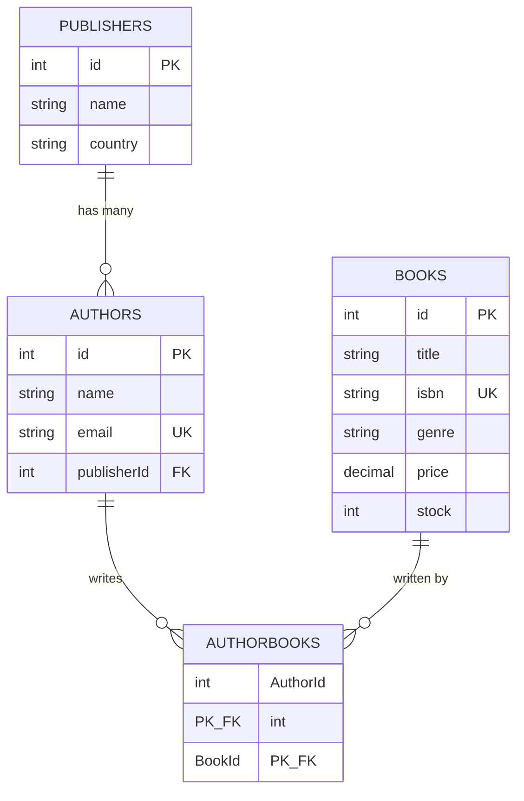

# Bookstore Inventory & Author Catalog

A full-stack mini project for **BCA Third Year – CSA-301 Full Stack Development**.
A bookstore administrator manages **publishers, authors, books and stock**, including the
relationships between authors and books.

- **ISA-II (backend):** `server/` – Node.js, Express, Sequelize, MySQL REST API
- **ISA-III (frontend):** `client/` – React (Vite) app that talks to the same API

> **Honest status note:** all code was written and syntax-checked, but it has **not been run against a real MySQL server or in a browser** by the person who generated it. Follow the testing checklist in section 12 on your own machine and tick items only after you have seen them work.

---

## 1. Problem statement and objectives

A small bookstore needs one place to keep its catalogue: who publishes, who writes, which books exist, and how many copies are on the shelf.

Objectives:
1. Design a normalised MySQL database with a one-to-many and a many-to-many relationship.
2. Build a REST API with validation, error handling, pagination and an advanced search + raw SQL report.
3. Build a React interface with routing, hooks and Context API that uses only the real API.

## 2. Technology stack

| Layer | Tools |
|---|---|
| Backend | Node.js, Express 4, Sequelize 6 (ORM), MySQL, mysql2, dotenv, cors, express-validator |
| Frontend | React 18, Vite, React Router 6, Axios, Context API, plain CSS |
| Tools | Git/GitHub, Postman, MySQL Workbench |

## 3. Features

- Dashboard with live statistics and recent books
- CRUD for publishers, authors, books
- Search, filter, sort and pagination for books (`/api/books/search`)
- Assign one or many authors to a book (saved in a database transaction)
- Inventory page: stock indicators, low-stock report (raw SQL), inline stock update

## 4. Architecture

```
React (Vite, :5173) --Axios--> Express API (:5000) --Sequelize--> MySQL (bookstore_inventory)
        pages/components        routes -> validators -> controllers -> models
```

## 5. Database design (ER diagram)



Plain-text version:

```
Publisher 1 ───── M Author M ───── N Book      (AuthorBooks connects Author and Book)
```

| Table | Columns | Notes |
|---|---|---|
| Publishers | id, name (unique), country, createdAt, updatedAt | |
| Authors | id, name, email (unique), publisherId (FK), createdAt, updatedAt | `ON DELETE RESTRICT` |
| Books | id, title, isbn (unique), genre, price DECIMAL(10,2), stock, createdAt, updatedAt | CHECK stock >= 0, price >= 0 |
| AuthorBooks | AuthorId (FK), BookId (FK), createdAt, updatedAt | composite PK; `ON DELETE CASCADE` |

### One-to-many: Publisher → Author
One publisher has many authors; each author belongs to exactly one publisher. The foreign key `Authors.publisherId` stores the link.
Sequelize: `Publisher.hasMany(Author, {as:'authors'})` and `Author.belongsTo(Publisher, {as:'publisher'})`.
**Delete rule:** a publisher that still has authors **cannot be deleted** (`RESTRICT`; the API replies 409). This was chosen so authors are never deleted or orphaned silently.

### Many-to-many: Author ↔ Book
An author can write many books and a book can have many authors, so neither table can hold the link in one column. The junction table `AuthorBooks` holds one row per (author, book) pair. Its composite primary key `(AuthorId, BookId)` prevents duplicates.
Sequelize: `Author.belongsToMany(Book, {through: AuthorBook, as:'books'})` and `Book.belongsToMany(Author, {through: AuthorBook, as:'authors'})`.
**Delete rule:** deleting an author or a book removes only its `AuthorBooks` rows (`CASCADE`).

### Application validation vs database constraints
- **Application validation** (express-validator + Sequelize validators) runs first and gives friendly messages (400).
- **Database constraints** (NOT NULL, UNIQUE, FOREIGN KEY, CHECK) are the last safety net; they hold even if someone bypasses the API. Both are used.

## 6. Folder structure

```
FSD_Mini_Project/
├── server/
│   ├── config/         config.js (sequelize-cli), database.js (app connection)
│   ├── controllers/    publisher, author, book, dashboard logic
│   ├── middleware/     asyncHandler, errorHandler, notFound, validateRequest
│   ├── migrations/     4 migrations (Publishers, Authors, Books, AuthorBooks)
│   ├── models/         Publisher, Author, Book, AuthorBook, index (associations)
│   ├── routes/         one file per resource
│   ├── utils/          AppError, pagination
│   ├── validators/     express-validator rules
│   ├── .env.example  .sequelizerc  package.json  server.js
├── client/
│   ├── src/api/        axiosInstance + one file per resource
│   ├── src/components/ reusable UI pieces
│   ├── src/context/    AppContext.jsx
│   ├── src/hooks/      useDebounce.js, useFetch.js
│   ├── src/layouts/    MainLayout.jsx
│   ├── src/pages/      Dashboard, Publishers*, Authors*, Books*, Inventory, NotFound
│   ├── src/styles/     global.css, layout.css, components.css
│   └── .env.example  package.json  vite.config.js  index.html
└── docs/               postman_collection.json, VIVA_AND_DEMO.md
```

There is intentionally **no `seeders/` folder**: the assignment accepts a migration *or* a seed file, and this project uses migrations. Add sample data through the React forms or Postman.

## 7. Installation (Windows, PowerShell)

**Prerequisites:** Node.js 18+ (`node -v`), MySQL **8.0.16 or newer** (older versions ignore CHECK constraints), Git.

### Backend (ISA-II)

```powershell
cd server
npm install
copy .env.example .env
```
Open `server\.env` in a text editor and set `DB_USER` and `DB_PASSWORD` to your MySQL login.

Create the database (either way):
```powershell
npm run db:create
```
or in MySQL Workbench run: `CREATE DATABASE bookstore_inventory;`

Create the tables and start the API:
```powershell
npm run migrate
npm run dev
```
Success looks like: `Database connection OK` then `API running at http://localhost:5000/api`.
Check it: open <http://localhost:5000/api/health> → `{"success":true,"status":"ok","database":"connected"}`.

Other commands:

| Command | What it does |
|---|---|
| `npm run migrate:status` | shows which migrations have run |
| `npm run migrate:undo` | rolls back the last migration |
| `npm run migrate:undo:all` | drops all four tables (full rollback) |
| `npm start` | runs without auto-restart |

**Reset the database:** `npm run migrate:undo:all` then `npm run migrate`.

### Frontend (ISA-III) — open a second PowerShell window

```powershell
cd client
npm install
copy .env.example .env
npm run dev
```
Open <http://localhost:5173>. Keep both windows running (ports 5000 and 5173 do not clash).

## 8. API reference

Base URL: `http://localhost:5000/api`. Success: `{ "success": true, "data": ..., "pagination": ... }`. Error: `{ "success": false, "message": "...", "errors": [{field, message}] }`.
Lists accept `page` (default 1) and `limit` (default 10, max 100).

| Method | Path | Purpose |
|---|---|---|
| GET | `/health` | server + database check |
| GET | `/publishers?q=` | list / search publishers |
| GET | `/publishers/:id` | one publisher |
| POST | `/publishers` | create `{name, country}` |
| PUT | `/publishers/:id` | update |
| DELETE | `/publishers/:id` | delete (409 if it still has authors) |
| GET | `/publishers/:id/authors` | authors of a publisher |
| GET | `/authors?q=&publisherId=` | list / search / filter authors |
| GET | `/authors/:id` | author with publisher and books |
| POST | `/authors` | create `{name, email, publisherId}` |
| PUT | `/authors/:id` | update |
| DELETE | `/authors/:id` | delete |
| GET | `/authors/:id/books` | books written by an author |
| GET | `/books` and `/books/search` | advanced book search (same handler, see below) |
| GET | `/books/low-stock?threshold=5` | raw-SQL low-stock report |
| GET | `/books/genres` | distinct genres (for dropdowns) |
| GET | `/books/:id` | book with authors and their publishers |
| POST | `/books` | create `{title, isbn, genre, price, stock, authorIds:[..]}` |
| PUT | `/books/:id` | update (optional `authorIds` replaces the authors) |
| PUT | `/books/:id/authors` | replace authors `{authorIds:[..]}` |
| PATCH | `/books/:id/stock` | set stock `{stock}` |
| DELETE | `/books/:id` | delete |
| GET | `/dashboard/stats?threshold=` | counts and totals |
| GET | `/dashboard/recent-books?limit=` | newest books |

**Status codes:** 200 OK, 201 created, 204 deleted, 400 invalid input, 404 not found, 409 duplicate or still-referenced record, 503 database unavailable, 500 unexpected error.

**Why `PATCH /books/:id/stock` exists:** the inventory screen changes one number. A small endpoint is safer than resending title, ISBN, price and authors through `PUT /books/:id`.

### Example requests

Create a book with two authors:
```
POST /api/books
{ "title": "Coastal Algorithms", "isbn": "978-1-23456-789-7", "genre": "Technology",
  "price": 499.5, "stock": 12, "authorIds": [1, 2] }
```
Response shape (`201`):
```
{ "success": true, "message": "Book created",
  "data": { "id": 1, "title": "Coastal Algorithms", "isbn": "978-1-23456-789-7",
            "genre": "Technology", "price": 499.5, "stock": 12,
            "authors": [ { "id": 1, "name": "...", "publisher": { "id": 1, "name": "..." } }, ... ] } }
```
Duplicate ISBN (`409`): `{ "success": false, "message": "A book with ISBN \"978-1-23456-789-7\" already exists" }`
Negative stock (`400`): `{ "success": false, "message": "Validation failed", "errors": [ { "field": "stock", "message": "Stock must be a non-negative whole number" } ] }`

### Advanced query endpoint: `GET /api/books/search`

Parameters (all optional, combinable): `q` (title, ISBN or genre), `genre`, `authorId`, `publisherId` (publisher of an associated author), `minPrice`, `maxPrice`, `inStock` (`true`/`false`), `sortBy` (`title|price|stock`), `order` (`ASC|DESC`), `page`, `limit`.

Example: `/api/books/search?genre=Fiction&inStock=true&minPrice=100&maxPrice=900&sortBy=price&order=DESC`

How it works: Sequelize `Op.like`, `Op.gte`, `Op.lte`, `Op.gt`; author/publisher filters use sub-queries on `AuthorBooks`, so a book keeps *all* its authors in the reply. Sorting accepts only the whitelisted columns above.

### Raw SQL endpoint: `GET /api/books/low-stock`

```sql
SELECT b.id, b.title, b.isbn, b.genre, b.price, b.stock,
       ROUND(b.price * b.stock, 2) AS stockValue,
       COALESCE(GROUP_CONCAT(a.name ORDER BY a.name SEPARATOR ', '), '') AS authors
  FROM Books b
  LEFT JOIN AuthorBooks ab ON ab.BookId = b.id
  LEFT JOIN Authors a ON a.id = ab.AuthorId
 WHERE b.stock < :threshold
 GROUP BY b.id, b.title, b.isbn, b.genre, b.price, b.stock
 ORDER BY b.stock ASC, b.title ASC
 LIMIT :limit OFFSET :offset
```
Run with `sequelize.query(sql, { replacements, type: QueryTypes.SELECT })`; every value is bound through `replacements`, nothing is concatenated. **Why raw SQL here:** the report joins three tables, folds many authors into one text column (`GROUP_CONCAT`) and computes a stock value in one round trip. The React *Inventory → Low-stock report* tab calls it, so it really executes.

Definition used: *low stock* in this report = `stock < threshold` (includes out-of-stock books). The dashboard card "Low stock" counts `0 < stock < threshold`, and "Out of stock" counts `stock = 0`, so those two never overlap.

## 9. React concepts used (and why)

| Concept | Where | Why |
|---|---|---|
| Components + props | `StatCard`, `DataTable`, `SearchBar`, `Pagination`, `FormField` | reuse the same UI with different data |
| `useState` | forms, filters, page number, dialogs | values that change what the screen shows |
| `useEffect` | `hooks/useFetch.js`, `useDebounce.js`, `ConfirmDialog` | load data when a page opens or a filter changes; cleanup cancels stale work |
| `useContext` | `context/AppContext.jsx` (`useApp`) | share notifications and a "data changed" counter across all pages |
| `useMemo` | `BookForm` author filter | recompute the filtered list only when its inputs change |
| `useCallback` | `AppContext`, `Books` handlers | stable functions for child components and effect dependencies |
| `useRef` | `SearchBar` focus, notification id counter | keep a value/DOM element without re-rendering |
| React Router | `App.jsx`, `Sidebar` (`NavLink`), `useNavigate`, `useParams` | page navigation; `*` route shows `NotFound` |

**Context API as shared state:** `AppContext` stores toast notifications and `dataVersion`. After any create/update/delete a page calls `refreshData()`; the Dashboard and Inventory pages list `dataVersion` as a dependency and reload. API data itself stays inside each page, not in global state.

**How a form updates MySQL:** form state → submit → client validation → `createBook()` (Axios) → `POST /api/books` → validator → controller → Sequelize transaction → MySQL → JSON reply → toast + navigate to the list, which fetches fresh data.

## 10. Design decisions

- Price is `DECIMAL(10,2)` (exact money values); the API returns it as a number. The UI shows the ₹ symbol – change it in the pages if you prefer another currency.
- Duplicate email / ISBN / publisher name are checked in the controller for a clear 409 message **and** enforced by UNIQUE indexes.
- Book + author links are saved in one **transaction**, so a book is never saved without its authors.
- `useFetch` is a small custom hook that wraps `useEffect` + loading/error state so each page stays short.
- Dropdowns load up to 100 publishers/authors (the API's maximum page size). Very large catalogues would need a search-as-you-type picker.

## 11. Troubleshooting

| Problem | Fix |
|---|---|
| `Could not connect to the database` | start MySQL; check `DB_USER`, `DB_PASSWORD`, `DB_PORT` in `server\.env` |
| `Access denied for user` | wrong MySQL username/password in `.env` |
| `Unknown database 'bookstore_inventory'` | run `npm run db:create` or create it in Workbench |
| `Database tables not found` | run `npm run migrate` in `server` |
| Migration fails on `CHECK` | MySQL older than 8.0.16 – upgrade, or remove the two `ALTER TABLE ... CHECK` lines |
| `Cannot reach the server` in React | backend not running, or wrong `VITE_API_BASE_URL` in `client\.env` (restart `npm run dev` after editing) |
| CORS error in browser console | `CLIENT_URL` in `server\.env` must be exactly `http://localhost:5173` |
| `EADDRINUSE` | port already used; change `PORT` in `server\.env` and `VITE_API_BASE_URL` |
| PowerShell blocks `npm` scripts | run `Set-ExecutionPolicy -Scope CurrentUser RemoteSigned` once |

## 12. Testing checklist (tick only what you have actually seen work)

Import `docs/postman_collection.json` into Postman (variable `baseUrl` = `http://localhost:5000/api`). Create a publisher, then authors, then books **in that order** (IDs in the sample requests assume your first records have id 1, 2, 3 – adjust to yours).

**Database (check in MySQL Workbench)**
- [ ] Four tables exist after `npm run migrate`
- [ ] Foreign keys: `Authors.publisherId`, `AuthorBooks.AuthorId`, `AuthorBooks.BookId`
- [ ] Duplicate email / ISBN rejected
- [ ] Negative stock / price rejected
- [ ] Same author cannot be linked twice to the same book
- [ ] `migrate:undo:all` then `migrate` works on a clean database

**API (Postman)**
- [ ] Health, then CRUD for publishers, authors, books
- [ ] Publisher with authors cannot be deleted (409)
- [ ] `/books/search` with several filters, `/books/low-stock`
- [ ] `PUT /books/:id/authors`, `PATCH /books/:id/stock`
- [ ] 400 / 404 / 409 cases in the "Errors" folder of the collection

**Frontend (browser)**
- [ ] Every sidebar link works; unknown URL shows "Page not found"
- [ ] Add publisher → author → book with two authors; the book shows on both author pages
- [ ] Edit and delete (with confirmation dialog) work
- [ ] Search, filters, sort and pagination on Books
- [ ] Inventory: update stock, low-stock report, badges change
- [ ] Dashboard numbers change after adding/deleting data
- [ ] Layout works on a narrow window

## 13. Known limitations and future ideas

Limitations: no login (single admin assumed), no automated tests, no image upload, dropdowns capped at 100 items, currency symbol is fixed in the UI.
Optional future ideas: authentication, CSV export, book cover images, stock-change history table, automated API tests.

See `docs/VIVA_AND_DEMO.md` for the 5-minute demo plan and viva answers.
